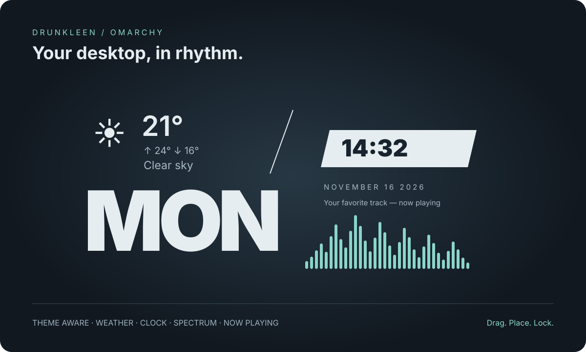
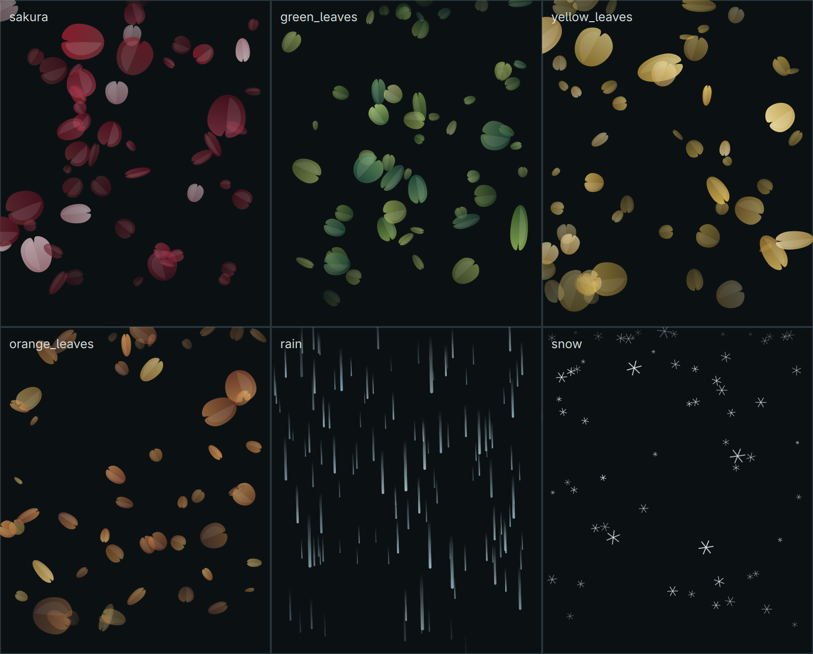

# Drunkleen Desktop AIO

**A little rhythm for your Omarchy desktop.**

Weather, a bold weekday, a clock and date, a live audio spectrum, and your
now-playing track — together in a compact card that follows your Omarchy theme.



*Layout illustration with sample data. Colors follow your active theme.*

## Make it yours

- **Move it once.** Right-click → **Unlock position**, drag with the left mouse
  button, then right-click → **Lock position**. An accent outline marks edit mode.
- **Resize it.** While unlocked, drag the bottom-right corner, or right-click →
  **Size** for smaller/larger steps, percentage presets, or the configured size.
  The aspect ratio stays fixed; each monitor remembers its own size.
- **Keep it where it belongs.** Position is remembered per monitor, outside the
  plugin checkout. It survives shell restarts and plugin updates.
- **Stay out of the way.** A bottom-layer Wayland surface sits above the wallpaper
  and below application windows. Only the card accepts pointer input; it never
  takes keyboard focus.
- **Match your desktop.** Text and spectrum colors follow the current Omarchy
  theme. Override colors, fonts, scale, components, or monitor selection.
- **See the music.** Cava visualizes PipeWire playback; MPRIS provides track and
  artist information from compatible players.

## Install

Requires **Omarchy Quattro** with its Quickshell plugin system. This is an
Omarchy plugin, not a standalone Quickshell configuration.

Install the runtime dependencies:

```bash
omarchy pkg add cava inter-font ttf-material-symbols-variable curl
```

Add and enable the plugin:

```bash
omarchy plugin add https://github.com/drunkleen/drunkleen.omarchy-desktop-aio --enable
omarchy restart shell
```

For unattended setup, append `--yes` to the `plugin add` command.
Plugin ID: `drunkleen.desktop-aio`. Omarchy supplies Quickshell, Qt SVG, Bash,
and PipeWire; Inter and Material Symbols provide the intended typography.

## Configure

Personal settings live outside the Git checkout. Copy the defaults once:

```bash
mkdir -p "${XDG_CONFIG_HOME:-$HOME/.config}/drunkleen.desktop-aio"
cp ~/.config/omarchy/plugins/drunkleen.desktop-aio/config.toml \
  "${XDG_CONFIG_HOME:-$HOME/.config}/drunkleen.desktop-aio/config.toml"
```

Edit that personal file. Changes reload live; plugin updates leave it alone.
You can also create a smaller file containing only your overrides:

```toml
monitor = "all"       # or comma-separated names, e.g. "DP-2,eDP-1"
anchor = "bottom-right"
margin_x = 56
margin_y = 56
scale = 0.55
opacity = 1.0
clock24h = true
show_weather = true
show_spectrum = true
show_media = true

[weather]
city = "London"
units = "metric"     # or "imperial"
refresh_seconds = 900
```

See [config.toml](config.toml) for every option, including component visibility,
fonts, ink/accent overrides and spectrum settings. Anchors accept `top-left`,
`top-center`, `top-right`, `center-left`, `center`, `center-right`, `bottom-left`,
`bottom-center`, `bottom-right`, and `free`. With `free`, set `x` and `y`.
Saved drag positions take precedence over configured anchors for that monitor.
`scale` is relative to the 708 × 454 design box.

### Saved placement

The lock state, per-monitor size, and normalized positions are stored at:

```text
${XDG_STATE_HOME:-~/.local/state}/drunkleen.desktop-aio/placement.json
```

The file is written when you release a drag/resize, choose a size, or toggle the lock, never into your
plugin checkout or dotfiles. Positions stay within the screen when its size
changes. Dragging is within a monitor; `monitor` controls which displays show a
card. The lock toggle applies to all cards.

To return to configured anchors, disable the plugin, move `placement.json` to a
backup, then enable it and restart the shell.

## Network and local access

With `show_weather = true`, the configured city is sent to Open-Meteo's HTTPS
geocoding API and its coordinates to the forecast API. Forecasts refresh every
15 minutes by default (minimum one minute); no API key or automatic location
lookup is used. Set `show_weather = false` to stop weather requests. Requests
have time and size limits. [Open-Meteo](https://open-meteo.com/) supplies weather
under [CC BY 4.0](https://open-meteo.com/en/licence).

Cava reads the PipeWire playback monitor for visualization. MPRIS track metadata
is read locally over the session bus. The plugin invokes `curl`, `mkdir`, and
its bundled Cava helper. It needs no root access and runs inside Omarchy's shell.

## Update, disable, remove

```bash
omarchy plugin update drunkleen.desktop-aio --yes
omarchy restart shell

omarchy plugin disable drunkleen.desktop-aio
omarchy plugin remove drunkleen.desktop-aio
```

Personal config and saved placement are intentionally retained. Remove those
separately if you want a completely fresh start.

## Troubleshooting

| Symptom | Check |
| --- | --- |
| Card is missing | Enable `drunkleen.desktop-aio`, restart the shell, and check `monitor` against `hyprctl monitors`. |
| Card will not move | Right-click and choose **Unlock position** first. Application windows must not cover the card. |
| Spectrum is flat | Play audio, check `cava` is installed, and ensure PipeWire playback is available. |
| Weather is unavailable | Check the configured city, internet access, and `show_weather`. The clock works without weather. |
| Icons look wrong | Install `ttf-material-symbols-variable` and restart the shell. |

## Development

```bash
git clone https://github.com/drunkleen/drunkleen.omarchy-desktop-aio
cd drunkleen.omarchy-desktop-aio
omarchy plugin validate .
node --test tests/*.test.cjs
bash -n scripts/cava-stream
```

The root `manifest.json` declares a `service` entry point in `Service.qml`.
`Config.qml` watches personal overrides; `Theme.qml` follows Omarchy colors;
`Weather.qml`, `AudioBars.qml`, and `Media.qml` supply the card's data.
Please include your Omarchy version and relevant shell log when reporting bugs.

## Credits and license

Created by [drunkleen](https://github.com/drunkleen). Adapted from
[Ryoku](https://github.com/Ryoku-dev/ryoku)'s desktop AIO design, audio bars and
weather code mapping. See [NOTICE](NOTICE) for attribution and source paths.

Distributed under [GPL-3.0-only](LICENSE). No Ryoku daemon or theme-generation
runtime is required. This is a community plugin and is not affiliated with the
Omarchy project.

## Interactive settings (1.2)

Right-click the desktop card for lock/unlock, a **Size** submenu, an **Anchor**
submenu, weather visibility, measurement units, the 24-hour-clock switch,
**Configure…**, and **Edit config file**. Values and selections stay synchronized
with the personal TOML file. Submenus scroll and stay within the current screen;
click outside or press Escape to close them. Size changes require unlocking.
Anchor changes apply to the monitor you clicked, clear that monitor's saved drag
position, and preserve its size and all other monitors' state.

**Configure…** opens a single native window with eight categories:

| Category | Settings |
| --- | --- |
| General | Clock format, independent component visibility, panel live preview |
| Weather | City suggestions with region/country, units, refresh interval, manual refresh and request status |
| Appearance | Widget opacity, default scale, display/icon fonts, foreground/accent overrides, follow theme and category reset |
| Placement | Actual connected monitors, display selection, 3×3 anchors, free coordinates, margins, lock and saved position/size resets |
| Components & Layout | Visibility, stacking order, visual position editor, snap-to-grid, individual and full layout resets |
| Audio Spectrum | Visibility, bar count, frame rate, smoothing and sensitivity |
| Media | Independent now-playing visibility and maximum text width |
| Advanced | Editor/directory integration, reload, TOML import/export and confirmed resets |

Changes apply immediately and save automatically after 300 ms of inactivity.
The opacity setting affects the card artwork, never the menu or settings window.
At near-zero opacity an interaction outline remains on the desktop. If you lose
track of the card, reopen settings through the service's recovery IPC:

```bash
omarchy-shell desktopAio configure
```

The desktop surface never requests keyboard focus. The menu requests focus only
while visible; the settings window uses normal window focus. Tab/Shift+Tab and
standard text-field/slider keys work in settings; Escape closes the active menu,
confirmation, or settings window.

### City search and weather

Type at least two characters and choose a suggestion to save a location.
Country and region distinguish namesakes. Empty, invalid, or failed searches do
not replace the saved location. Search is debounced; obsolete requests are
canceled and generation-checked. Unit/location changes trigger a fresh forecast;
disabling weather cancels the forecast and its refresh timer. Search requests
are explicit and independent of desktop weather visibility, so a disabled card
can still be configured. Closing settings cancels any outstanding city search.

### Layout editing

The component list runs **back to front**: reordering changes actual stacking,
not coordinates. Drag a list handle up/down and release, or use the arrow
buttons for the selected component. Overlap is intentional and supported.

Drag a component outline inside the preview to change its position, or select it
and edit its X/Y values. Arrow keys move the selected component (8 design pixels
with snapping, 1 without). Hidden components remain selectable in the editor.
Positions are bounded to the 708 × 454 design canvas. Weather, weekday, clock,
date, media and spectrum each have independent visibility and coordinates.
Now-playing no longer depends on date visibility. The decorative divider hides
if its related components are hidden or repositioned, so it does not become an
orphaned decoration. Without customization, the original coordinates and
artistic composition are retained. The default spectrum has 34 rendered bars;
existing explicit bar-count settings are now respected by the renderer.

### Persistence, compatibility and resets

User settings remain in `${XDG_CONFIG_HOME:-~/.config}/drunkleen.desktop-aio/config.toml`.
The plugin's bundled `config.toml` is read-only defaults. The editor action
creates a personal file when necessary and uses `omarchy launch editor`.
Placement remains version 1 JSON, with an optional `anchors` map added alongside
`monitors`, `sizes`, and `locked`. Existing position/size files need no migration
or deletion. Screen disconnection retains its saved state for reconnection;
positions and effective sizes are clamped to available screen geometry.

Configuration edits preserve unknown settings, unrelated comments, and section
ordering where practical. Writes patch only changed keys, use atomic FileView
writes, and reread disk before saving. Unrelated external edits are merged;
conflicting edits to the same key stop the save and show an error instead of
silently overwriting the editor's value. Reload discards pending UI changes and
reads the file again. Malformed configuration is reported and never replaced
with defaults automatically. After repairing it in your editor, reload or save
the file to resume interactive updates.

The TOML document editor supports booleans, finite integers/floats, escaped and
literal strings, multiline strings, arrays, dotted keys, nested sections, inline
tables, comments, and unknown date/time values. Unsupported constructs such as
arrays of tables are rejected with an error, preserving the original file.
There are no such constructs in the plugin's configuration schema.

Import/export use an explicit absolute file path in Advanced. **Import** validates
before asking for confirmation, then merges the supplied keys, preserving
unrelated settings and all placement state. **Export** writes effective settings
(including defaults) after confirmation. Resets and imports require confirmation:
category resets affect only that category; layout resets affect only component
positions/order; personal-configuration reset leaves monitor state alone. Only
**Reset configuration and all placement state** clears positions, sizes, anchors
and the lock state too. Removing a saved position restores configured placement;
removing a saved size restores the configured scale.

New backward-compatible configuration keys include:

```toml
show_weekday = true
live_preview = true

[weather]
# Written when choosing a validated city suggestion:
label = "Dresden, Saxony, Germany"
location_city = "Dresden"
latitude = 51.05
longitude = 13.74

[layout]
order = ["weather", "weekday", "clock", "date", "media", "spectrum"]
snap = true

[layout.clock]
x = 392
y = 74
```

Equivalent `layout.<component>.x/y` settings work for all six components. Omit a
position key to use its original coordinate. Personal `scale` remains the default;
per-monitor sizes in placement state override it. The appearance scale slider
also clears the selected monitor's saved size so the change is visible there.
Margins/free-coordinate defaults are shared; placement actions in the panel
explicitly target the selected connected monitor.

### Validation and runtime checks

```bash
omarchy plugin validate .
node --test tests/*.test.cjs
bash -n scripts/cava-stream scripts/check-runtime
shellcheck scripts/cava-stream scripts/check-runtime tests/runtime/curl
./scripts/check-runtime
```

The optional runtime check requires an unlocked Omarchy Wayland session. It
opens a temporary settings window, exercises all categories, persistence and
external-edit merging, city suggestions, live unit changes and cancellation,
and an edge-of-screen context menu. It uses temporary XDG directories and
fixture HTTPS responses; it never edits personal settings or calls the real
weather API. It exits nonzero if the expected completion marker is absent or
runtime QML errors are logged.

Manual release verification should still cover real audio devices, physical
monitor unplug/replug, pointer drags/resizing, keyboard navigation, fractional
scaling, and both light/dark themes. The automated tests cover document editing,
validation, resets/imports, legacy state, per-monitor precedence, layout models,
request-generation handling and the Cava helper.

## Ambient & seasonal effects (1.3)

Desktop AIO now hosts the existing Sakura Rain renderer: the same vector petal
silhouette, shading, perspective depth, flutter, window avoidance, and
click-through **background** layer, extended with seasonal palettes and
precipitation. There is one fixed particle pool and one motion clock per monitor,
not a separate renderer for each effect. No images are downloaded, no emoji are
rendered, and no additional weather provider is used.



Open **Configure… → Ambient Effects**, or right-click → **Ambient Effects** for
quick selection. Available choices are:

- **Disabled** — immediately stops and clears particle animation.
- **Automatic** — current precipitation first, then meteorological season.
- **Sakura petals** — original burgundy/pink petal palette and falling motion.
- **Green leaves**, **Yellow leaves**, **Orange leaves** — the same artistic
  silhouette with varied green, gold, amber and brown gradients.
- **Rain** — fast, elongated, subtly wind-slanted vector streaks.
- **Snow** — slow, drifting six-armed vector flakes.

Manual choices always override automatic selection. Disabling sets only
`ambient.enabled = false`; the last selected mode is retained for re-enabling.
Existing configurations without `[ambient]` retain the **Sakura** default.
Automatic is available but never forced on existing installations.

### Automatic selection

Precipitation has priority in every season and hemisphere:

1. **Snow:** WMO 71, 73, 75, 77, 85, 86.
2. **Rain:** drizzle/freezing drizzle 51, 53, 55, 56, 57; rain/freezing rain 61,
   63, 65, 66, 67; showers 80, 81, 82; thunderstorms 95, 96, 99.
3. **Otherwise:** spring Sakura, summer green leaves, autumn orange leaves,
   winter no particles. Winter alone never produces artificial snow.

Northern seasons are March–May, June–August, September–November, and
December–February. A configured latitude below zero reverses these by six months.
The equator and unavailable/invalid latitude use a documented **Northern
Hemisphere** fallback. Yellow leaves are available as a manual palette.

The configured location's date is calculated from the existing Open-Meteo UTC
offset when available. Without it, the computer's local date is used. Selection
updates on weather/location changes, mode changes, month boundaries, startup,
and clock jumps after resume. The panel displays the resolved effect and reason.

Ambient effects never start weather requests. They reuse the existing forecast
only while weather is enabled, current and matched to the configured city. With
weather disabled, unavailable, or in an error state, Automatic uses seasonal
fallback; valid configured/cached location metadata can still determine the
hemisphere and date. Manual modes never add weather polling.

### Controls and configuration

All settings use the existing personal TOML, live setters and atomic persistence.
Changing opacity here affects particles, independently of card opacity. The
live preview uses the same renderer inside the settings window and pauses when
hidden. Irrelevant controls are disabled while effects are off.

```toml
[ambient]
enabled = true
mode = "sakura"      # auto | sakura | green_leaves | yellow_leaves | orange_leaves | rain | snow
density = 0.4        # 0..1
speed = 0.5          # 0.1..2; 0.5 preserves original Sakura speed
opacity = 0.75       # 0..1
size = 1.0           # 0.25..3; multiplier
wind = 0.3           # 0..3; 0.3 preserves original Sakura drift
preview = true      # settings-window live preview
```

Unknown modes and invalid values are rejected by the configuration API without
rewriting the file. The renderer also normalizes unsafe values defensively.
**Reset ambient settings** requires confirmation and resets only this section.

### Existing standalone Sakura service

The prior animation lives in the separate `sakura-rain` user service. To avoid
two full-desktop overlays, AIO checks for a running/enabled legacy service or a
running legacy Quickshell configuration before mapping its desktop effects.
An enabled legacy service is treated as the owner even before it starts, avoiding
a session-start race. The AIO preview remains available while the legacy service
owns the desktop.

In Ambient Effects, **Use Desktop AIO effects…** asks for confirmation, then stops
and disables that legacy service and closes its Quickshell instance. It preserves
its files and configuration; AIO's new settings remain in the personal AIO TOML.
No automatic takeover occurs during installation or testing. Existing nondefault
Sakura Rain tuning is not imported automatically—use the ambient controls to
match it before confirming the handoff. **Recheck standalone overlay** refreshes
the ownership check if you change the old service externally.

The default original background scope is retained across all monitors,
independent of the AIO card's monitor selector. Particles fade under normal
windows and pause on fullscreen workspaces. Input regions remain empty.

### Rendering lifecycle

The fixed pool is capped at **128 particles per monitor**, including retiring
particles during effect transitions. Mode switches retire old particles and fade
new ones in over roughly 650 ms inside the same pool. Disabled effects clear
immediately and stop their timer. Zero density drains existing particles and
then stops; zero opacity pauses processing. Hidden/fullscreen surfaces and
hidden previews stop their motion clocks. Speed, opacity, size and drift update
existing particles live; density changes reconcile the existing pool.

The optional isolated runtime suite now checks ambient controls, pause/resume,
manual/automatic transitions, a fixed pool, and that frame counts stop when
disabled or at zero density. Policy tests cover every precipitation code, both
hemispheres, all months and boundaries, missing data, invalid input, compatibility
and persistence. Physical monitor reconnect/fullscreen behavior and long-running
GPU/power usage remain manual release checks.

### 1.3.1 interaction fixes

The context menu uses native, scrolling submenus with automatic edge placement,
keyboard navigation and Escape handling. It opens after the right button is
released. Settings selectors retain their configuration bindings and select the
clicked item without requiring a prior hover. Particle density changes reconcile
the existing pool immediately, with the usual fade, rather than waiting for slow
natural spawning. The same selector is used for effects, units, anchors and
monitors.

An additional real-input regression check is available:

```bash
./scripts/check-runtime controls.qml
```

It clicks the actual controls, verifies persistence/binding synchronization,
checks rendered particle size and prompt density changes, and exercises native
submenu selection and Escape/focus release. Temporary configurations are used.
